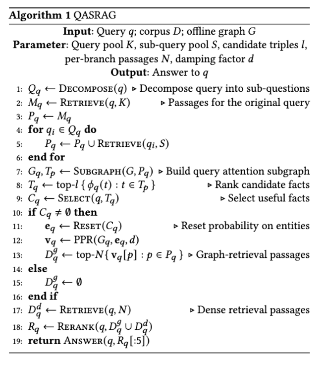
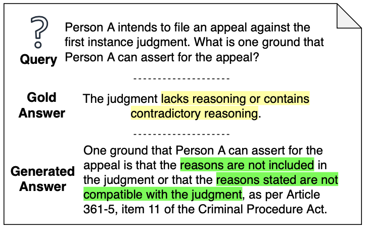

# QAS: Query-decomposition-Augmented Subgraph PPR for Legal Multi-hop Retrieval

## Environment setup

Conda 

```bash
conda env create -f environment.yaml
conda activate qasrag
```

or pip into an existing Python 3.10 environment:

```bash
pip install -r requirements.txt
```

Set the API key (the OpenAI SDK reads it from the environment):

```bash
export OPENAI_API_KEY=         # gpt-4o-mini pipeline + gpt-4o LF judge
```

A GPU is required for the NV-Embed embedder.

## Offline indexing

Build the index from the corpus **before** running evaluation (embeds every
passage with NV-Embed and runs OpenIE to construct the entity/fact knowledge
graph):

```bash
python index_corpus.py --config configs/koblex.yaml            # full corpus
```

Outputs: `index/corpus_graph/chunk_embeddings/vdb_chunk.parquet`,
`index/corpus_graph/graph.pickle`, and the OpenIE caches under `index/openie/`.


## Evaluation

```bash
python run_eval.py --config configs/koblex.yaml --qa            # Recall@5 + Token-F1
python run_eval.py --config configs/koblex.yaml --qa --lf       # + LF-Eval (gpt-4o judge)
```


## Single question

```bash
python run_query.py --question "Until what point can Person B claim damages against Person A?" \
    --background "Person A entered a transport contract with Person B "
```


##  Notations and Pseudo Code

Table A1 summarizes a list of notations commonly used throughout this paper. Algorithm A1 provides a pseudo code of the proposed QASRAG method.

**Table A1. Notations used throughout the paper.**

| Symbol | Meaning |
|---|---|
| \(D\) | Corpus of \(L\) passages |
| \(G=(V,E)\) | Offline knowledge graph |
| \(V_P, V_E\) | Passage and entity vertices of corpus-level graph |
| \(V_P', V_E'\) | Passage and entity vertices of subgraph |
| \(E_R, E_C, E_S\) | Relation, context, synonym edges |
| \(q, Q_q\) | Query and sub-queries \((q_1,\ldots,q_h)\) |
| \(M_q\) | Passages selected for original query |
| \(S_q\) | Passages selected for each sub-query |
| \(P_q\) | Candidate passage pool (attention) |
| \(T_p\) | Triples from candidate passage pool |
| \(G_q=(V_q,E_q)\) | Query-attention subgraph |
| \(T_q\) | Triple set for LLM selection |
| \(C_q\) | Selected triples for extracting seed nodes in PPR |
| \(\mathbf{e},\mathbf{v},d\) | Reset probability vector, PPR scores, damping factor |
| \(D_q^g\) | Ranked passages from graph-based retrieval for query \(q\) |
| \(D_q^d\) | Ranked passages from dense retrieval for query \(q\) |
| \(R_q\) | Final top-5 reranked passages |


##  QASRAG Algorithm

The overall pipeline of QASRAG is shown below.

<p align="center">
  
</p>

---

##  Implementation Details

For the offline indexing and knowledge graph construction, we use NV-Embed-v2 (7B) [lee2025nv] as our embedding method and GPT-4o-mini [openai_gpt4o_mini_2024] for OpenIE. For fair comparison, we use the same retriever and same LLM for OpenIE across all graph-based methods.

In addition, our question answering phase uses the following models and hyperparameters. We use NV-Embed-v2 [lee2025nv] for the dense retrieval branch, and for all query-passage and query-triple similarity in the graph-based retrieval branch.

In our graph-based retrieval, the pool sizes are \(K=100\) for the main query and \(S=10\) per sub-question. The LLM triple filter receives \(l=10\) candidate triples per question and may keep an unbounded subset. Similar to HippoRAG 2 [gutierrez2025rag], the graph uses a synonym threshold \(\tau=0.80\), and PPR damping \(d=0.5\).

We experimented with passage weight and used \(\alpha=0.25\) in our case. The LLM reranker receives top-\(N=10\) ranked passages from dense and graph retrieval and the LLM-driven answer generation receives the top-5 passages.

ParSeR and IRCoT follow the retrieval setup of their original papers. For fair comparison, we adapted the same legal specific prompt for the question answering LLM across all the baselines and our method.

Further, as the core LLM, we conduct experiments with three different LLMs to better evaluate the performance gains and generalizability under different setups:

1. **GPT-4o-mini** [openai_gpt4o_mini_2024], which is a proprietary model.
2. **Qwen3-14B** [yang2025qwen3], which is a larger open-weight model.
3. **Ministral-3-8B** [mistral8b2512], which is a small open-weight model.

For the methods that use an LLM inside the retrieval pipeline, i.e., HippoRAG 2, LogicRAG, ParSeR, and QASRAG, the same model drives both the inference-time retrieval steps and the final question answering.

For the remaining methods whose retrieval uses no LLM, the model is varied only at the question answering stage.

Answer quality is evaluated identically across all models with LF-Eval [openai2024gpt4o] using GPT-4o as the core LLM model.

All model calls use temperature \(0\). All hyperparameters are held fixed across questions and benchmarks. All experiments are run on a single NVIDIA A100-SXM4 (40 GB) GPU.

---

##  Effect of Dense Embedding Models on QASRAG

We also tested our method's efficiency with different dense embedding models and the results (with GPT-4o-mini core) are shown in Table A2.

In fact, we used bge-large-en-v1.5 (335M) [xiao2024c], NV-Embed-v2 [lee2025nv], and GTE-Qwen2-7B [li2023towards] and compute Recall@5 under two configurations:

1. When these embeddings are used for dense retrieval (i.e., Dense-Recall@5).
2. When these embeddings are used as QASRAG's retrieval backbone (QASRAG-Recall@5).

**Table A2. Effect of the dense embedding models on QASRAG. Dense-Recall@5 is the retrieval performance of the embedding model and QASRAG Recall@5 is its performance on the QASRAG pipeline.**

| Embedding Model | Dense-Recall@5 | QASRAG-Recall@5 |
|---|---:|---:|
| bge-large-en-v1.5 | 46.5 | 60.1 |
| GTE-Qwen2-7B-Instruct | 57.6 | 68.2 |
| NV-Embed-v2 (7B) | 57.8 | **70.1** |

QASRAG with bge-large reaches 60.1 Recall@5 where bge-large's dense Recall@5 is 46.5, while with GTE-Qwen2-7B, we achieve 68.2 Recall@5 which is higher than their Recall of 57.6.

This shows that the components of QASRAG increase the retrieval performance by +10.6 to +13.6.

NV-Embed-v2 and GTE-Qwen2-7B have comparable dense Recall, but NV-Embed-v2 gives higher performance on both metrics when used within QASRAG.

---


##  A Case Study on Token-F1 and LF-Eval

In the Discussion section, we analyzed how Token-F1 and LF-Eval can differ based on the generated answers. Here, we examine another case where token-F1 does not completely capture the semantic quality of the generated answer.

The following example presents a response that is legally correct but receives a low token-F1 of **0.09** and a high LF-Eval of **0.95**.

<p align="center">
  
</p>

In this example, the generated answer provides additional supporting explanation beyond the ground-truth answer which is short. Although the legal conclusion is consistent with the reference, the extra tokens reduce lexical overlap and therefore lower token-F1. This suggests that, in some cases, low token-F1 may result from differences in answer length and phrasing rather than incorrect semantic content.
